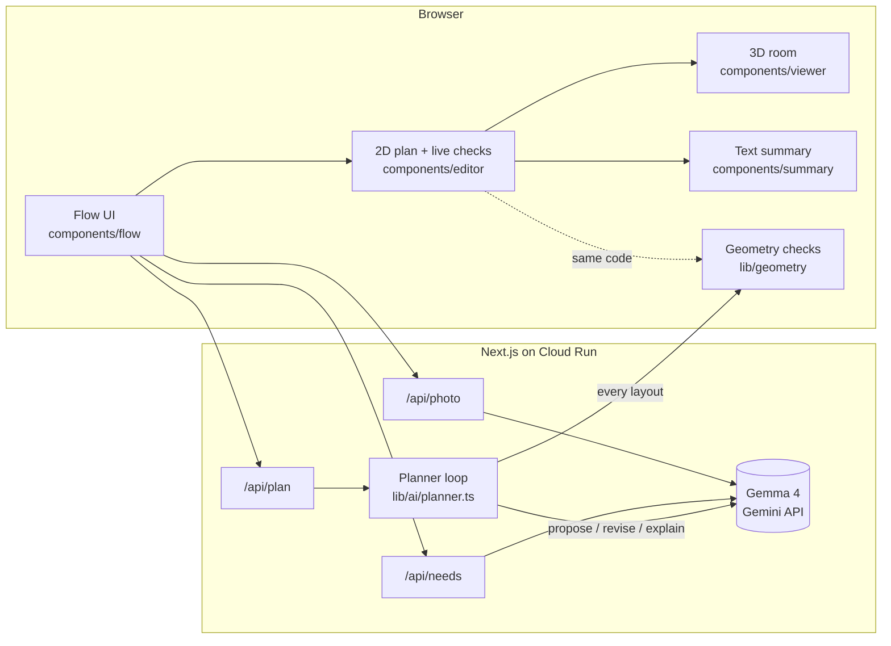

# Room Fit (working title)

> Before you sign a lease, see how your life fits.

Renters looking at a smaller, cheaper apartment can't tell from empty listing photos whether their bed, desk and couch will fit, or whether a wheelchair can still turn around. Room Fit takes a room you confirm, asks what you need in plain words, and has Gemma 4 propose two furniture layouts. A deterministic geometry checker tests every layout. It sends the problems back to Gemma and allows at most two revisions. Then you walk through the result in 3D.

Built at GDG Build with AI x Hacktoberfest 2026 (Virginia Tech) by MLH Team 28.

**Live demo:** _URL goes here after T-402._

## How it works

1. **Room.** Start from the example studio, your own measurements, or a photo. Gemma estimates the size and finds doors and windows from the photo.
2. **Check the measurements.** Estimated values are marked until you confirm them. Every later check runs against these numbers.
3. **Your needs.** "I use a wheelchair, I want a full bed and a small desk…" becomes an editable furniture list from a catalog with real sizes. Wheelchair use adds a 60 in turning circle.
4. **Two layouts.** Gemma proposes. The checker looks for furniture outside the room, overlapping pieces, anything in a door's swing or in the clear space at a door, and whether a turning circle fits. It sends exact problems back ("Loveseat is in the swing of the door on the south wall by 15 in"). A layout that still fails is shown as not fitting, never as passing. Each option shows every round it went through.
5. **Walk through.** A live-checked 2D plan you can drag or use with the keyboard, a 3D room with overview and first-person walk modes, and a text summary you can print.



The model never decides whether something fits. `lib/geometry` is pure, deterministic and unit-tested. It runs on the server to judge Gemma's layouts and in the browser to re-check every move you make.

## Running it

Requires Node 22+.

```bash
npm install
cp .env.example .env.local   # then add GEMINI_API_KEY
npm run dev                  # http://localhost:3000
```

| Variable | Needed for | Notes |
| --- | --- | --- |
| `GEMINI_API_KEY` | `/api/photo`, `/api/needs`, `/api/plan` | Server only. Without it those routes return 503, and the app falls back to the paths below. |
| `GEMMA_MODEL` | same | Defaults to `gemma-4-26b-a4b-it`. |
| `WORLDLABS_API_KEY` | the World Labs experiment (T-404) | Optional. |

Other scripts: `npm test` (vitest), `npm run typecheck`, `npm run lint`, `npm run build`.

Deploying: see [docs/DEPLOY.md](docs/DEPLOY.md). A human runs the deploy.

## Reproducing the demo

Without an API key, everything except the AI calls still works:

1. Open `/` and choose **Use the example studio**.
2. Press **These are right, continue**.
3. Leave the example text as it is and press **Turn this into a list**. Because the AI isn't connected, choose **Use the prepared reading of the example**.
4. Press **Suggest two layouts**, then **Show the prepared example**. These two layouts were written by hand and are labeled that way, but each round is checked live: option 1 is rejected for the loveseat in the door swing, then revised.
5. Choose a layout, drag the couch back over the door to see the check fail live, then open **3D room** and **Walk through**.

`/editor` opens the editor directly, with a three-seat sofa in the door swing. Use **Try smaller** to swap in the loveseat.

Sample needs to try with a key:

- "I use a wheelchair, so I need room to turn around. I want a full bed with a nightstand, a small desk and chair for school, a small couch for when friends visit, and a little table for two."
- "I work from home and need a real desk, a queen bed, a dresser, and somewhere for two people to eat."

## Responsible AI

- **Estimated vs confirmed.** Every dimension carries its source. Estimates from a photo or from our defaults look different (dashed amber, "Estimated") until you confirm them, and the summary counts how many are still estimated.
- **No certification claims.** We say a layout "passed the checks against the room you confirmed". We never say accessible, compliant or certified. Gemma's explanations are rejected and replaced with a template if they use those words, or if they contain any number that isn't in the room, the catalog or the checker's results.
- **What the checks don't cover.** They cover footprints only. The turning circle is checked for floor space, not for a clear path to it. Furniture sizes are typical retail sizes. The summary lists these limits.
- **Photos.** The browser downscales and re-encodes the photo, which removes EXIF data including GPS. It is sent inline to Google's Gemini API, never uploaded to the Files API, and never written to disk or logged by our server. Logs hold only the call label, model, latency and token counts. Google's API terms cover what happens on their side, and we say so in the UI.
- **Generated views.** Staged photos and 3D worlds (T-403, T-404) are labeled as design concepts, not to scale. The 3D room built from the checked plan is the one we stand behind.
- **Prepared examples are labeled.** When the AI is unavailable, the prepared layouts are marked as hand-written stand-ins.

## Accessibility

- Every step works with the keyboard. In the plan, arrow keys move the selected item (Shift for 1 ft steps), R rotates it, and Delete removes it.
- The 3D view has on-screen movement buttons and click-to-walk, and respects `prefers-reduced-motion`.
- The text summary gives the whole layout without the 3D canvas or the plan.
- Automated checks: axe is clean on every step at desktop and phone widths, and Lighthouse accessibility scores 100. We have not yet tested with a real screen reader.

## Project docs

- [INTERIOR_DESIGN_PLAN.md](INTERIOR_DESIGN_PLAN.md): product plan and locked decisions
- [TASKS.md](TASKS.md): task board and claim protocol
- [AGENTS.md](AGENTS.md): rules for humans and AI agents working in the repo
- [docs/DEPLOY.md](docs/DEPLOY.md): Cloud Run deploy

## License

MIT. See [LICENSE](LICENSE).
